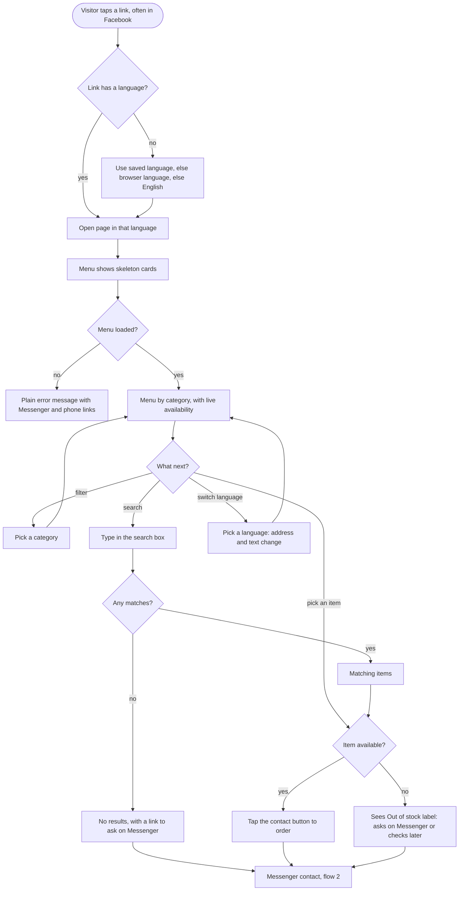
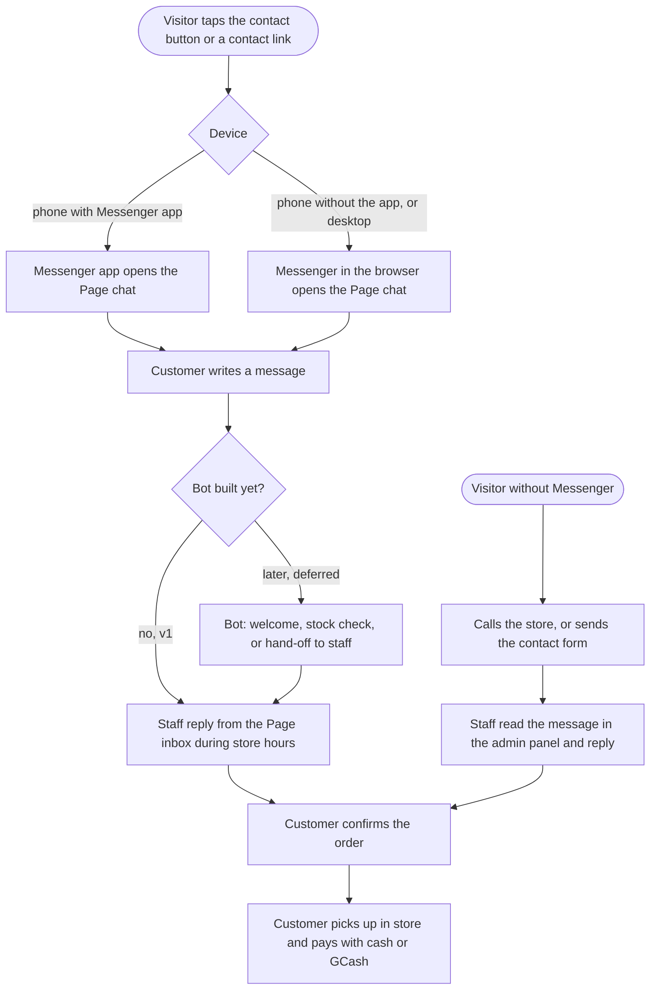
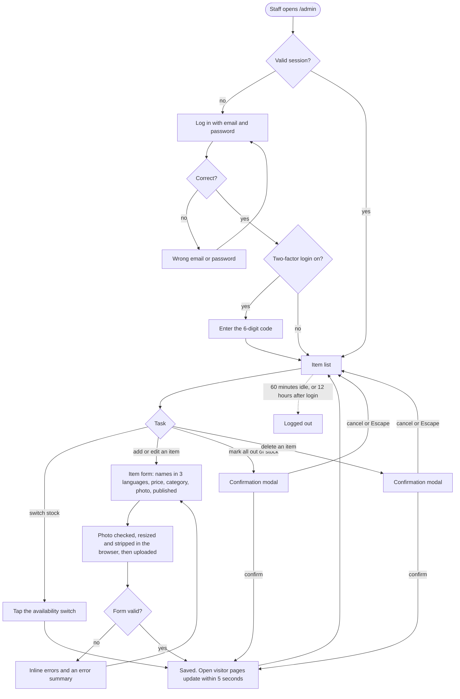

# App Flows

| | |
|---|---|
| Status | 1.0, approved by the owner on 2026-10-18 |
| Last updated | 2026-10-18 |

This document owns the **step-by-step user flows**. The rules each step must follow are in [SRS.md](SRS.md), and what happens inside the system during these flows is in [SDD.md, section 7](SDD.md#7-key-flows).

## 1. Browse and search

From opening a link to finding an item. Most visitors arrive from Facebook, often inside its in-app browser.

Steps:

1. The visitor opens a link. If the address has no language (`/en/`, `/fil/`, `/ko/`), the site uses the saved choice, then the browser's language, then English (FR-18 to FR-20).
2. Skeleton cards show while the menu loads (FR-10). If it cannot load, a plain message offers Messenger and the phone number (FR-11).
3. The menu shows published items by category. Availability updates live while the page is open (FR-01 to FR-06).
4. The visitor filters by category (FR-05), searches (FR-12 to FR-14), or switches language (FR-16, FR-17). Each happens without a page reload.
5. An available item leads to ordering through Messenger. An out-of-stock item shows its label (FR-04), and the visitor can still ask about it.

## 2. Messenger contact

How a visitor becomes a customer. Ordering, pickup and payment happen outside the site ([D-011](DECISIONS.md#d-011-pickup-only-orders-through-messenger)).

Steps:

1. Every page has a floating contact button, and every contact link opens the Page's Messenger chat (FR-27, FR-28).
2. In v1, staff answer in the Facebook Page inbox. The deferred bot will later send a welcome, answer stock questions, or hand off to staff (FR-49 to FR-51).
3. The customer confirms the order in the chat, then picks it up and pays in store with cash or GCash (FR-26).
4. A visitor who does not use Messenger can call (FR-24) or send the contact form (FR-29 to FR-31). Staff read it in the admin panel (FR-32) and reply by phone or email.

## 3. Admin editing

How staff keep the menu accurate, usually from a phone at the counter.

Steps:

1. Staff open `/admin` and log in. Any failure shows the same "Wrong email or password" message (FR-34 to FR-36). Staff who turned on two-factor login enter a code (FR-47).
2. The fastest task is switching an item's availability with one tap in the list (FR-39). Visitors see it within 5 seconds (FR-06).
3. Adding or editing an item uses one form. English is required and Filipino and Korean are optional (FR-38). A photo is checked and processed on the phone before upload (FR-43, FR-44).
4. Deleting an item and "mark all out of stock" ask for confirmation first (FR-40, FR-41).
5. The session ends after 60 minutes without activity or 12 hours after login (FR-46).
