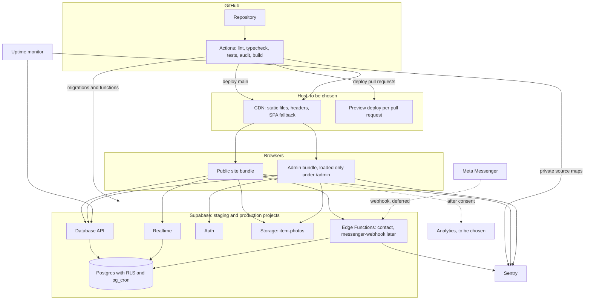

# Architecture

| | |
|---|---|
| Status | 1.0, approved by the owner on 2026-10-18 |
| Last updated | 2026-10-18 |

This document owns the **high-level view**: components, deployment, hosting, caching, scaling, error tracking and backups. How each part works inside is in [SDD.md](SDD.md), and the database is in [BACKEND-SCHEMA.md](BACKEND-SCHEMA.md).

## 1. Components and deployment

Everything that runs, where it runs, and how code gets there. Dashed lines are deferred or need consent.

## 2. Components

| Component | Runs on | Job |
|---|---|---|
| Public site bundle | Visitor's browser | Menu, search, languages, store information, consent. Size budget in NFR-PERF-02 |
| Admin bundle | Staff browser, loaded only under `/admin` | Editing items, categories and photos, reading contact messages |
| `theme-init.js` | Browser, a tiny script loaded in `<head>` before the app | Applies the saved or system theme before first paint (FR-66), without an inline script (NFR-SEC-11) |
| Host CDN | To be chosen ([D-003](DECISIONS.md#d-003-hosting-deferred)) | Serves static files with security headers and the SPA fallback |
| Database API | Supabase | Menu reads and staff writes. Every request runs as `anon` or `authenticated`, so RLS applies |
| Realtime | Supabase | Sends `menu_state` changes to open pages ([D-020](DECISIONS.md#d-020-live-updates-through-a-one-row-version-table)) |
| Auth | Supabase | Staff login and two-factor login. Sign-ups are turned off |
| Storage | Supabase | Item photos |
| `contact` function | Supabase Edge Functions | Contact form ([D-005](DECISIONS.md#d-005-server-code-runs-on-supabase-edge-functions)) |
| `messenger-webhook` function | Supabase Edge Functions | Messenger bot (Deferred, [D-004](DECISIONS.md#d-004-messenger-bot-deferred)) |
| Postgres | Supabase | Data, RLS, triggers and scheduled jobs |
| Sentry | Sentry | Errors from browsers and functions |
| Analytics | To be chosen with the host | Visits and Messenger taps, after consent |
| Uptime monitor | To be chosen with the host | Checks the site and the menu API (NFR-REL-03) |
| GitHub Actions | GitHub | CI and deployment |

## 3. Deployment

| Change | Pull request | Merge to `main` |
|---|---|---|
| Frontend | CI checks, then a preview deploy that uses the staging Supabase project | Production deploy from `main` only |
| Database | Migrations tested against a local Supabase stack in CI, including the RLS tests | Applied to staging, then to production after the owner approves in GitHub (protected environment) |
| Edge Functions | Tested in CI | Deployed with the migrations, staging first |

- The production frontend deploys only after production migrations succeed, so the site never expects tables that do not exist yet.
- Database changes only move forward: a mistake is fixed by a new migration. Backups (section 8) cover disasters.
- Frontend rollback uses the host's previous deploy (NFR-REL-05), once a host is chosen.
- Where secrets live:

| Place | Holds |
|---|---|
| Host settings | Public values only: Supabase URL, anon key, Sentry DSN |
| GitHub Actions secrets | Supabase access token and database passwords for migrations, Sentry auth token for source maps |
| Edge Function secrets | `CONTACT_IP_SALT` (salt for hashing IP addresses) and `ALLOWED_ORIGINS` (the site's exact origins); later, the Meta app secret, verify token and Page token. The service role key is provided by Supabase |

## 4. Hosting

Deferred by the owner ([D-003](DECISIONS.md#d-003-hosting-deferred)). The checklist the host must meet is in [TRD 2.1](TRD.md#21-what-the-host-must-support). Until then the build stays host-neutral: a `dist/` folder of static files, with headers and caching rules kept in one config file in the repository and translated to the chosen host's format in step 10.

## 5. Caching

| What | Cache rule | Why |
|---|---|---|
| JavaScript, CSS and fonts with a content hash in the name | `public, max-age=31536000, immutable` | The name changes whenever the content does |
| `index.html` and `theme-init.js` | `public, max-age=0, must-revalidate` | Each visit checks for a new release, so pages never point at deleted files. Meets NFR-PERF-04's 5-minute ceiling |
| Favicons and web manifest | `public, max-age=86400` | Rarely change |
| Item photos | `max-age=31536000`, set at upload | Each photo version has its own path ([BACKEND-SCHEMA 6](BACKEND-SCHEMA.md#6-storage)) |
| Menu data | Not cached | Read live from the Database API on every load and change (NFR-PERF-04) |

If a release removes a file that an open tab still needs (for example the admin bundle), the page shows "A new version is available" with a reload button instead of failing.

## 6. Scaling

The expected load is one shop's customers, so the design favors simplicity, with these limits in mind:

- **Frontend:** static files on a CDN; no servers to scale.
- **Database connections:** the browser and the functions both use the Database API over HTTP, which pools connections, so nothing opens direct database connections.
- **Live updates:** each open page holds one Realtime connection. Supabase plans cap concurrent connections, and the free plan's cap is low, so check the current figure before launch. Over the cap, pages fall back to checking `menu_state` every 10 seconds ([D-020](DECISIONS.md#d-020-live-updates-through-a-one-row-version-table)).
- **Menu reloads:** every change makes each open page reload the published menu. At a few hundred items this is a small response (estimated well under 100 KB compressed). Bulk changes cause one reload, not one per item. If the menu grows past about 2,000 items, switch to loading only changed items. The Database API also returns at most 1,000 rows per request (`max_rows`), and the public site reads all published items in one request, so past 1,000 published items the reads must be paged.
- **Indexes:** listed in [BACKEND-SCHEMA 5](BACKEND-SCHEMA.md#5-indexes).

## 7. Error tracking and monitoring

| What | How |
|---|---|
| Browser errors | Sentry, in the public and admin bundles. Each release is tagged with its git commit |
| Function errors | Sentry, from each Edge Function |
| Source maps | Uploaded privately from CI to Sentry, never deployed (NFR-SEC-07) |
| Personal data | Scrubbed before sending ([SDD 6](SDD.md#6-error-handling-and-logging)) |
| Alerts | Sentry emails the owner about new error types and spikes, including repeated function failures (NFR-REL-02) |
| Uptime | A monitor checks the site and a menu read every 5 minutes and alerts the owner (NFR-REL-03). Service chosen with the host |
| Quotas | Supabase usage alerts warn before plan limits are reached |

## 8. Backups and recovery

NFR-REL-04 requires a restorable backup no older than 24 hours. Two options, to decide with the budget ([PRD Q6](PRD.md#8-open-questions)):

| Option | How | Cost |
|---|---|---|
| Supabase plan backups | Daily backups included in paid plans. Check what the free plan includes before relying on it | Paid plan |
| Nightly dump from CI | A scheduled GitHub Action dumps the database, encrypts it with a key only the owner holds, and stores it outside GitHub. Encryption is required because the repository is public | Free, more setup |

Either way, the restore steps are written down and tested once before launch. Item photos are not inside database backups. The owner keeps the original photos on the phone or computer they came from.
