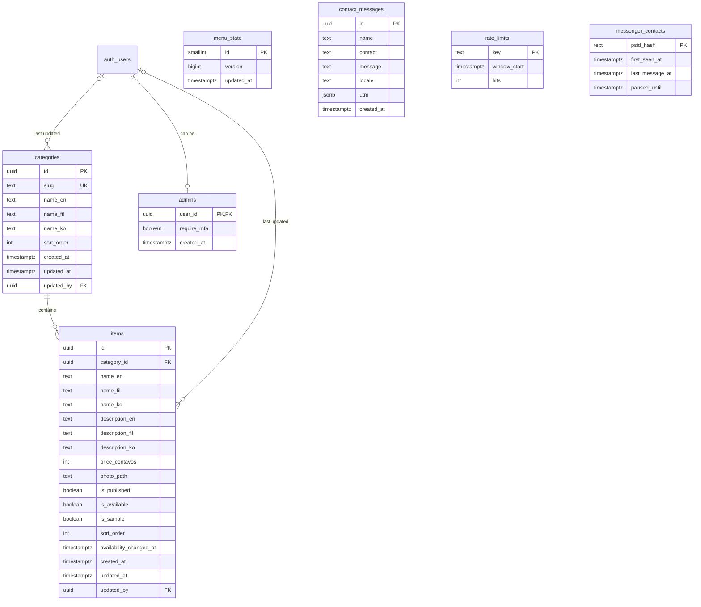

# Backend Schema

| | |
|---|---|
| Status | 1.0, approved by the owner on 2026-10-18 |
| Last updated | 2026-10-18 |

This document owns the **database**: tables, columns, indexes, Row Level Security policies, functions, scheduled jobs and storage rules. The database is Postgres on Supabase. Every change is made through a migration file in `supabase/migrations` (from step 4). How the frontend and functions use this data is in [SDD.md](SDD.md).

## 1. Entity relationships

How the tables relate. `auth_users` stands for Supabase's built-in `auth.users` table. Tables without lines stand alone.



## 2. Tables

All tables live in the `public` schema. Times are `timestamptz`, stored in UTC and shown in Philippine time ([TRD 5](TRD.md#5-localization)).

### 2.1 `categories`

| Column | Type | Rules |
|---|---|---|
| `id` | `uuid` | Primary key, `gen_random_uuid()` |
| `slug` | `text` | Unique. 1 to 40 characters, matching `^[a-z0-9]+(-[a-z0-9]+)*$`. Used in filter URLs |
| `name_en` | `text` | Required, 1 to 60 characters |
| `name_fil`, `name_ko` | `text` | Optional, 1 to 60 characters when set ([D-021](DECISIONS.md#d-021-translated-text-in-one-column-per-language)) |
| `sort_order` | `int` | Default 0 |
| `created_at`, `updated_at` | `timestamptz` | Set by default and by trigger |
| `updated_by` | `uuid` | References `auth.users`, on delete set null. Always set by trigger, never by the client |

### 2.2 `items`

| Column | Type | Rules |
|---|---|---|
| `id` | `uuid` | Primary key, `gen_random_uuid()` |
| `category_id` | `uuid` | Required. References `categories`, on delete restrict, so a category with items cannot be deleted (FR-42) |
| `name_en` | `text` | Required, 1 to 80 characters |
| `name_fil`, `name_ko` | `text` | Optional, 1 to 80 characters when set |
| `description_en` | `text` | Required but may be empty, up to 500 characters |
| `description_fil`, `description_ko` | `text` | Optional, up to 500 characters |
| `price_centavos` | `int` | Required, 0 to 10,000,000 (up to ₱100,000). Whole centavos avoid rounding errors |
| `photo_path` | `text` | Optional. Matches `^items/[0-9a-f-]{36}/[0-9]+$`, the folder prefix of the stored photo sizes ([section 6](#6-storage)) |
| `is_published` | `boolean` | Default `false`, so half-finished items stay hidden |
| `is_available` | `boolean` | Default `true` |
| `is_sample` | `boolean` | Default `false`. `true` only in seed data ([D-010](DECISIONS.md#d-010-sample-products-until-the-real-list-arrives)) |
| `sort_order` | `int` | Default 0, order within the category |
| `availability_changed_at` | `timestamptz` | Set by trigger when `is_available` changes. Feeds "Last updated" (FR-08) |
| `created_at`, `updated_at` | `timestamptz` | Set by default and by trigger |
| `updated_by` | `uuid` | References `auth.users`, on delete set null. Always set by trigger |

### 2.3 `admins`

| Column | Type | Rules |
|---|---|---|
| `user_id` | `uuid` | Primary key. References `auth.users`, on delete cascade |
| `require_mfa` | `boolean` | Default `false`. When `true`, this staff member can write only from a two-factor session (FR-47) |
| `created_at` | `timestamptz` | Default `now()` |

Only the owner adds or removes rows, in the Supabase dashboard ([D-001](DECISIONS.md#d-001-visitors-never-log-in-only-staff-do)). No client role can write here.

### 2.4 `menu_state`

One row only (`id = 1`, enforced by a check). Bumped by trigger whenever items or categories change. Visitors subscribe to it for live updates ([D-020](DECISIONS.md#d-020-live-updates-through-a-one-row-version-table)).

| Column | Type | Rules |
|---|---|---|
| `id` | `smallint` | Primary key, check `id = 1` |
| `version` | `bigint` | Increases by 1 per changing statement |
| `updated_at` | `timestamptz` | Time of the last change |

### 2.5 `contact_messages`

Written only by the `contact` server function. Deleted automatically when the retention period ends ([section 4.3](#43-scheduled-jobs)).

| Column | Type | Rules |
|---|---|---|
| `id` | `uuid` | Primary key |
| `name` | `text` | 1 to 80 characters |
| `contact` | `text` | 5 to 120 characters, a phone number or email address |
| `message` | `text` | 1 to 1,000 characters |
| `locale` | `text` | One of `en`, `fil`, `ko` |
| `utm` | `jsonb` | Optional. An object with only the five UTM keys, stored only with consent (FR-57) |
| `created_at` | `timestamptz` | Default `now()` |

### 2.6 `rate_limits`

Fixed-window counters used by server functions (NFR-SEC-16). Keys never contain raw IP addresses: they hold a salted SHA-256 hash.

| Column | Type | Rules |
|---|---|---|
| `key` | `text` | Primary key, for example `contact:<hash>` |
| `window_start` | `timestamptz` | Start of the current window |
| `hits` | `int` | Requests counted in the window |

### 2.7 `messenger_contacts` (Deferred)

Created in step 7, with the bot ([D-004](DECISIONS.md#d-004-messenger-bot-deferred)). Lets the bot know whether it has already welcomed a customer and whether staff have taken over.

| Column | Type | Rules |
|---|---|---|
| `psid_hash` | `text` | Primary key. Salted hash of the customer's Messenger ID |
| `first_seen_at`, `last_message_at` | `timestamptz` | |
| `paused_until` | `timestamptz` | Bot stays silent for this customer until then |

## 3. Row Level Security

Every table has RLS enabled. With no matching policy, a role gets nothing (NFR-SEC-01). On top of RLS, table privileges are cut down: Supabase's default grants to `anon` and `authenticated` are revoked, and only the privileges below are granted back.

`is_admin()` is defined in [section 4.1](#41-functions). The service role, used only inside server functions, bypasses RLS.

| Table | Operation | Roles | Allowed when |
|---|---|---|---|
| `categories` | select | `anon`, `authenticated` | Always (category names are public) |
| `categories` | insert, update, delete | `authenticated` | `is_admin()` |
| `items` | select | `anon`, `authenticated` | `is_published` or `is_admin()` (FR-07) |
| `items` | insert, update, delete | `authenticated` | `is_admin()` |
| `admins` | select | `authenticated` | `user_id = auth.uid()`: staff see only their own row |
| `admins` | insert, update, delete | none | Owner uses the dashboard |
| `menu_state` | select | `anon`, `authenticated` | Always |
| `menu_state` | update | `authenticated` | `is_admin()`, needed because the bump trigger runs as the staff member |
| `contact_messages` | select | `authenticated` | `is_admin()` (FR-32) |
| `contact_messages` | insert, update, delete | none | Only the `contact` function (service role) and the retention job |
| `rate_limits` | all | none | Only server functions (service role) |
| `messenger_contacts` | all | none | Only the webhook function (service role) |

Column privileges: `anon` can select only these `items` columns: `id`, `category_id`, the `name_*` and `description_*` columns, `price_centavos`, `photo_path`, `is_available`, `is_sample`, `sort_order` and `availability_changed_at`. `updated_by` and the timestamps used for auditing stay hidden from visitors.

## 4. Functions, triggers and jobs

Every function uses `SECURITY INVOKER` and `set search_path = ''`, and refers to tables by schema-qualified names (NFR-SEC-05). There are no `SECURITY DEFINER` functions. Execute rights are revoked from `public` and granted only to the roles listed.

### 4.1 Functions

| Function | Returns | Purpose | Callable by |
|---|---|---|---|
| `is_admin()` | `boolean` | True when the caller is in `admins`, and has a two-factor session if `require_mfa` is set | `anon`, `authenticated` (always false for `anon`) |
| `reorder_categories(p_ids uuid[])` | `void` | Sets `sort_order` from the array order, in one transaction. Raises an error if any row was not updated, which happens when RLS blocks the caller | `authenticated` |
| `reorder_items(p_category_id uuid, p_ids uuid[])` | `void` | Same, for items within one category | `authenticated` |
| `check_rate_limit(p_key text, p_max int, p_window_seconds int)` | `int` | Counts one hit in a fixed window with a single atomic upsert. Returns 0 if allowed, otherwise the seconds until the window resets (used for `Retry-After`) | `service_role` |
| `find_items_for_bot(p_query text)` | rows | Deferred. Trigram match of the query against published item names in all three languages, using `pg_trgm` | `service_role` |

`is_admin()` in full, because every write policy depends on it:

```sql
create function public.is_admin()
returns boolean
language sql
stable
security invoker
set search_path = ''
as $$
  select exists (
    select 1
    from public.admins a
    where a.user_id = (select auth.uid())
      and (not a.require_mfa or (select auth.jwt() ->> 'aal') = 'aal2')
  );
$$;
```

It works without `SECURITY DEFINER` because the `admins` select policy lets each user read their own row. Policies call it as `(select public.is_admin())`, so Postgres evaluates it once per statement, not once per row.

### 4.2 Triggers

| Trigger | Table | When | Does |
|---|---|---|---|
| `categories_before_write` | `categories` | Before insert or update, per row | Sets `updated_at = now()` and `updated_by = auth.uid()` |
| `items_before_write` | `items` | Before insert or update, per row | Same, and sets `availability_changed_at = now()` on insert or when `is_available` changes |
| `categories_bump_menu` | `categories` | After insert, update or delete, per statement | Adds 1 to `menu_state.version` and sets `updated_at` |
| `items_bump_menu` | `items` | After insert, update or delete, per statement | Same. Per statement, so "mark all out of stock" causes one live update, not hundreds |

### 4.3 Scheduled jobs

Run by `pg_cron`.

| Job | Schedule | Does |
|---|---|---|
| `purge-contact-messages` | Daily, 03:00 Philippine time | Deletes contact messages older than the retention period. Placeholder: 180 days until the owner answers [PRD Q9](PRD.md#8-open-questions) (NFR-PRIV-03) |
| `purge-rate-limits` | Hourly | Deletes counters whose window ended more than a day ago |
| `purge-messenger-contacts` | Daily (Deferred) | Deletes contacts not seen for 30 days |

## 5. Indexes

| Index | Columns | Used by |
|---|---|---|
| `items_category_sort_idx` | `items (category_id, sort_order)` | Menu ordering, admin list |
| `items_published_idx` | `items (category_id, sort_order) where is_published` | Visitor menu reads |
| `categories_sort_idx` | `categories (sort_order)` | Menu ordering |
| `categories_slug_key` | `categories (slug)`, unique | Filter URLs |
| `contact_messages_created_idx` | `contact_messages (created_at desc)` | Admin list, retention job |
| `rate_limits_window_idx` | `rate_limits (window_start)` | Cleanup job |
| `items_name_trgm_idx` | GIN trigram on `name_en`, `name_fil`, `name_ko` (Deferred) | Bot item lookup |

## 6. Storage

| Setting | Value |
|---|---|
| Bucket | `item-photos` |
| Public read | Yes, by direct URL only. No select policy exists, so nobody can list the bucket |
| Allowed types | `image/webp`, `image/jpeg` ([D-019](DECISIONS.md#d-019-photos-are-processed-in-the-staff-members-browser)) |
| Size limit | 1 MB per file, after processing |
| Path | `items/<item id>/<version>/<width>.<webp or jpg>`, with widths 320, 640 and 1024. `<version>` is the upload time in milliseconds, so a new photo never reuses a cached URL |
| Cache header | `max-age=31536000` (one year), safe because paths never change |
| Write policies on `storage.objects` | Insert, update and delete for `authenticated` when `bucket_id = 'item-photos'` and `is_admin()` (NFR-SEC-14) |

When a photo is replaced or its item deleted, the admin panel deletes the old folder's files.

## 7. Seed data

Used only in local and staging databases ([TRD 3](TRD.md#3-environments)), never in production.

- The four categories from the store's banner: Snacks and Drinks, Beauty and Skincare, Instant Noodles, Household Essentials.
- About twelve sample items, all with `is_sample = true` and made-up prices, chosen to exercise the requirements: available and out-of-stock items (FR-04), one hidden item (FR-07), one without a photo (FR-03), and items missing Filipino or Korean text (FR-21).
- One test staff account in the local database only. Staging and production staff accounts are created by the owner.
