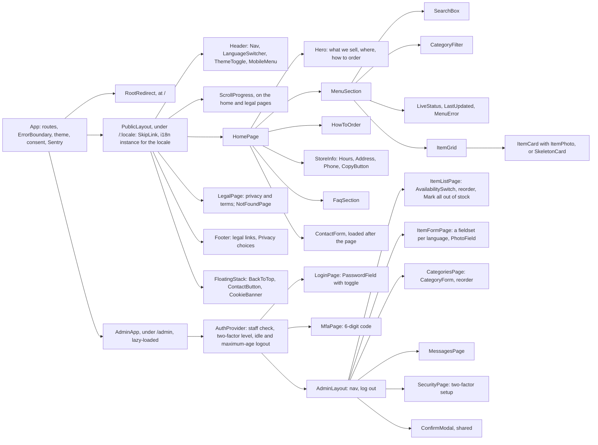
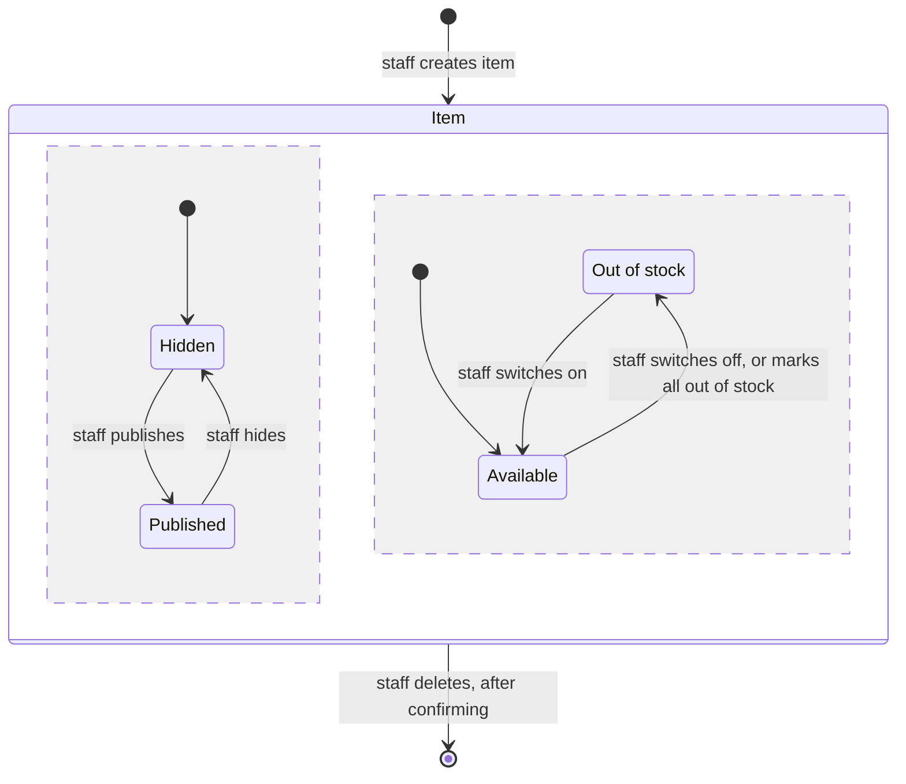
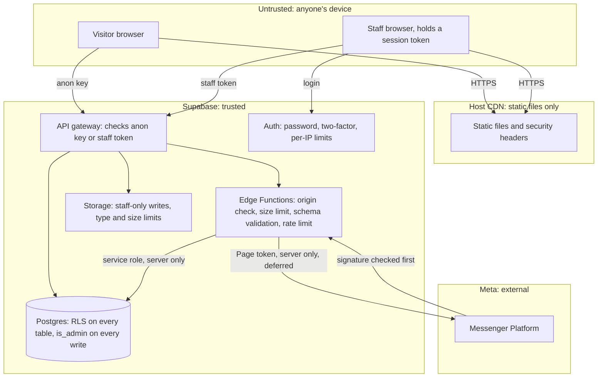
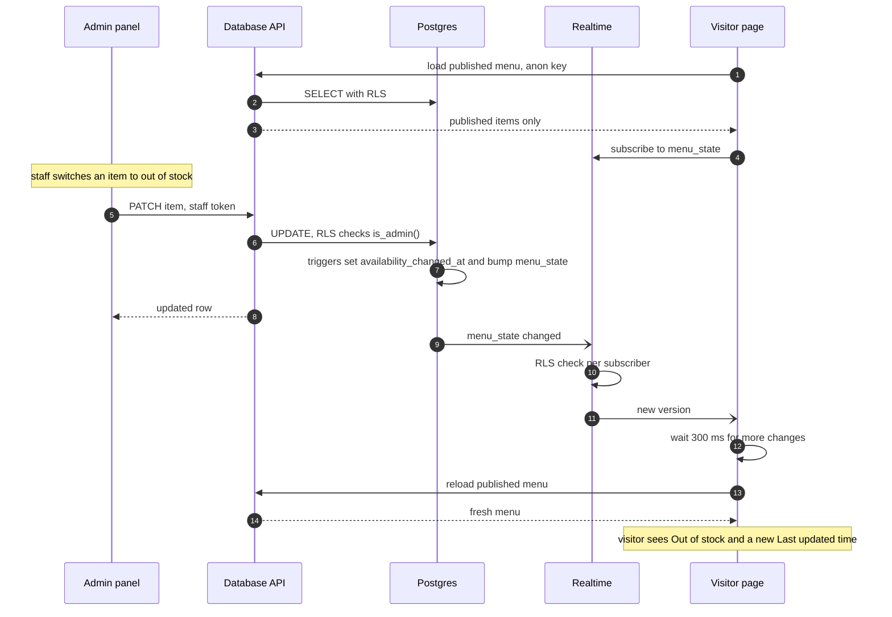
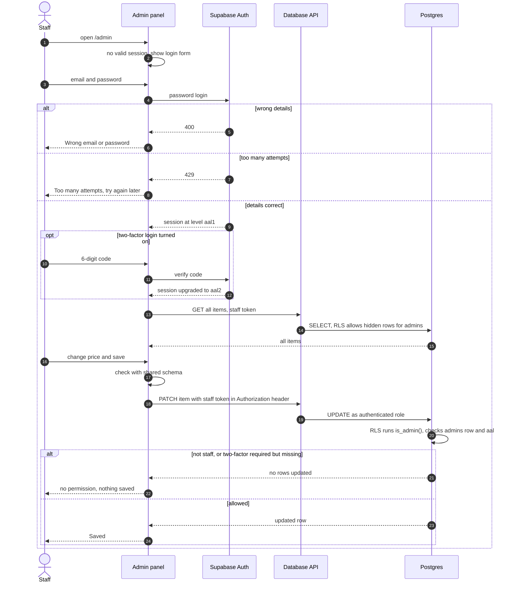
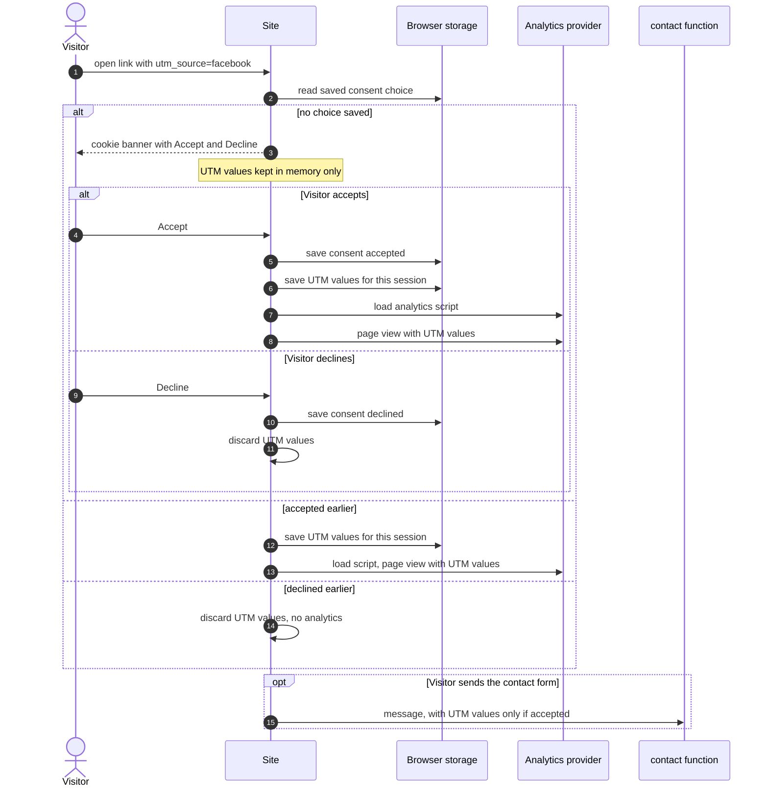
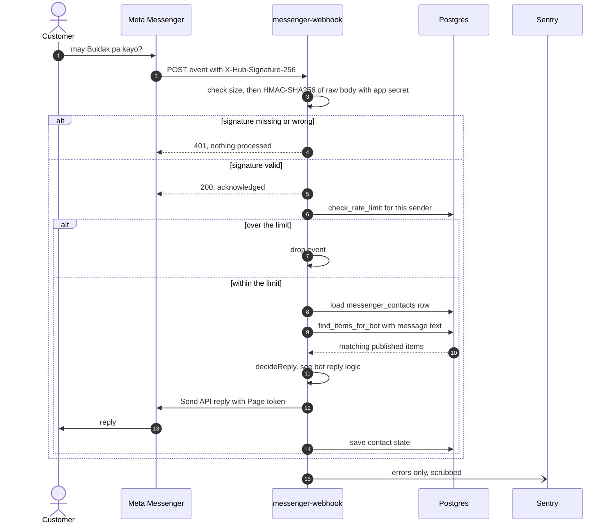
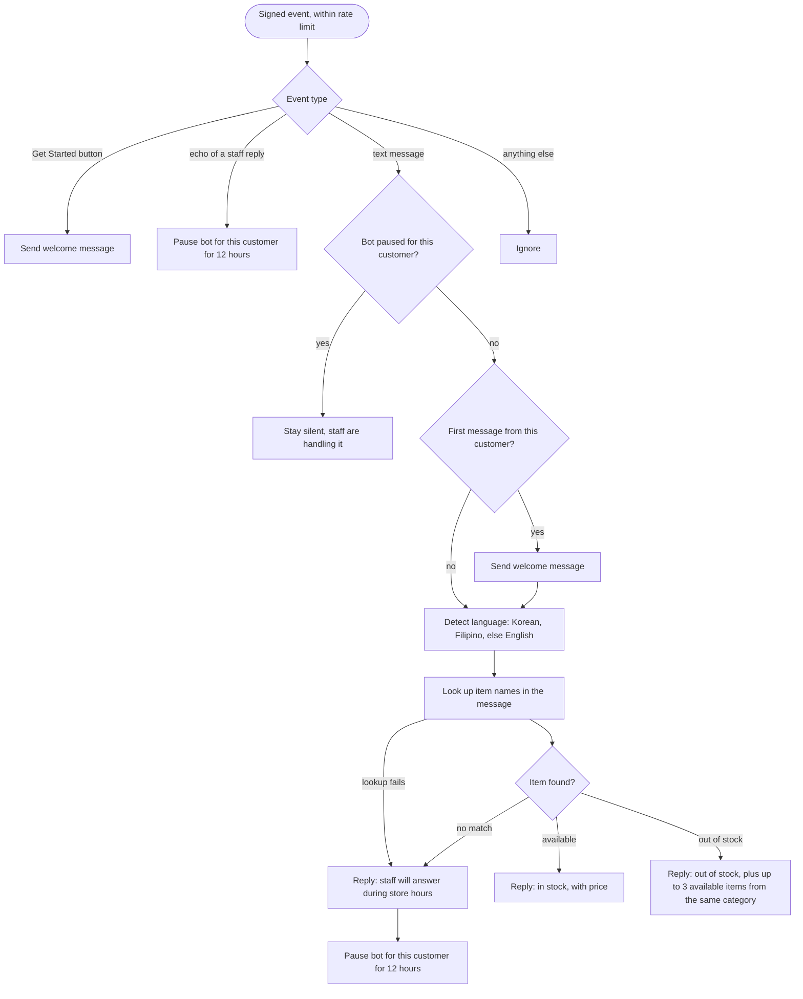

# Software Design Description

| | |
|---|---|
| Status | 1.0, approved by the owner on 2026-10-18 |
| Last updated | 2026-10-19 |
| Structure | Based on IEEE 1016 |

This document owns **how each part is built**. It refers to requirement IDs in [SRS.md](SRS.md) and decisions in [DECISIONS.md](DECISIONS.md) instead of restating them.

## 1. Design overview

The high-level view (components, deployment, caching, scaling, monitoring) is in [ARCHITECTURE.md](ARCHITECTURE.md). In short: a React single-page app served as static files, talking directly to Supabase for data, login, live updates and photos, with server-side logic in Supabase Edge Functions. Security rests on Row Level Security in the database, not on the frontend.

## 2. Module design

### 2.1 Frontend structure

```text
src/
  app/          App shell, router, providers (i18n, theme, consent, Sentry)
  components/   Layout and shared UI
  features/
    catalog/  search/  i18n/  store-info/  contact/  faq/  consent/  legal/
    admin/      Loaded lazily, only under /admin
  lib/          Supabase client, Sentry setup, formatting, shared Zod schemas
  config/       Store facts (address, hours, phone, links)
public/         theme-init.js, favicons, web manifest
hosting/        Security headers and caching rules for any host (D-039)
supabase/
  migrations/   Database changes, in order
  functions/    contact/, messenger-webhook/ (Deferred)
  tests/        pgTAP database tests
  seed.sql      Sample data for local and staging only
```

- `src/config/store.ts` is the single source of store facts; [BRIEF.md](BRIEF.md#project-inputs) points to it.
- The admin feature is a separate lazy chunk, so visitors never download it (NFR-PERF-02).
- The public site talks to Supabase through its REST and Realtime clients only, never holding a login; the admin panel uses the full supabase-js client ([D-030](DECISIONS.md#d-030-the-public-site-uses-supabases-rest-and-realtime-clients-directly)).
- `src/lib/database.types.ts` types the tables the browser reads, in the shape `supabase gen types` produces. It is kept in step with the migrations by hand until a Supabase stack runs on the development PC.
- The router is created in `main.tsx`, so tests render `App` inside a memory router. Tests pass a fake menu source through `MenuSourceContext`.
- No CSS-in-JS library that injects `<style>` tags, because the CSP forbids inline styles ([section 5.5](#55-headers-and-content-security-policy)).

**Frontend component tree.** The main components and what they contain.



### 2.2 Public site modules

| Module | Design | SRS |
|---|---|---|
| catalog | Loads `menu_state.version`, categories and published items through the Database API, the version request first. Subscribes to `menu_state` changes and reloads the menu 300 ms after the last change event. Each time the subscription starts, and when the tab becomes visible again, it compares the version and reloads if it changed, which catches changes made before or between subscriptions. If Realtime fails, checks the version every 10 seconds instead and shows a "live updates paused" notice ([D-020](DECISIONS.md#d-020-live-updates-through-a-one-row-version-table)). A failed reload keeps the last menu on screen; a failed first load shows the error state, retried by the visitor or by the next check. Requests time out after 15 seconds. "Last updated" is the latest `availability_changed_at` among published items. Category filter is a `?category=<slug>` query, so filtered links can be shared. Photos load in the format stored with the item ([D-034](DECISIONS.md#d-034-an-items-photo-format-is-stored-with-it)), and the placeholder shows if a file cannot load. Shows a "Sample" label and notice on sample items outside production. The logic lives in `liveMenu.ts`, free of React, so it is unit-tested with fake timers | FR-01 to FR-11, NFR-REL-01 |
| search | Builds an in-memory index from the loaded menu: for each item, the current language's and English name, description and category name, normalized (Unicode NFKC, lowercase, collapsed spaces). Every word of the query must appear, in any order. Runs within the selected category, on each keystroke through React's deferred value. Input is only ever compared as text ([D-017](DECISIONS.md#d-017-search-runs-in-the-browser)) | FR-12 to FR-15, NFR-PERF-05 |
| i18n | Routes under `/:locale`; any other first segment goes back to the root. The root route picks a language from the saved choice, then `navigator.languages` (`tl` counts as Filipino), then English, keeping the query string. Only an explicit choice in the language menu is saved, so opening someone's shared link in another language does not change the visitor's default. One i18next instance per language, chosen by the route, so a switch re-renders the page in one step without a reload. Sets `<html lang>` before paint, formats prices and times with `Intl` ([TRD 5](TRD.md#5-localization)). Fallback text gets its own `lang` attribute. Translation keys are type-checked, and a unit test keeps the three languages' keys identical | FR-16 to FR-21, NFR-ACC-05 |
| store-info | Reads store facts from `config/store.ts`. Hours are stored per day as opening and closing times; a closing time at or before the opening time means the next day. Copy buttons use the Clipboard API, falling back to selecting the text with a hint to copy it where the API is blocked. Announces "Copied" through a live region. "How to order" is a three-step list with a Messenger button | FR-22 to FR-26 |
| contact | Floating button and all contact links use the Messenger link from store facts. The contact form validates with the shared schema (`supabase/functions/_shared/contactSchema.ts`) for instant feedback, then posts to the `contact` function with `fetch`, which validates again ([section 3.2](#32-contact-function)). Campaign details go along only with consent. On success a thank-you replaces the form and takes focus. The form is loaded after the rest of the page, so its validation library stays out of the first download | FR-27 to FR-31, NFR-SEC-17 |
| faq | Questions and answers are per-language JSON files (`src/features/faq/faq.<locale>.json`), shown as native `<details>` elements. Entries marked `todo` show a "Draft" tag outside production, and a Vite plugin fails any build with `VITE_APP_ENV=production` while one remains | FR-33 |
| consent | Privacy banner in the floating stack, stored choice (kept in memory when storage is blocked), footer "Privacy choices" to change it. Captures the five UTM values at start-up, keeps them in memory until Accept, then in `sessionStorage`; Decline discards them ([section 7.3](#73-cookie-consent-analytics-and-utm)). No analytics provider is chosen yet ([D-036](DECISIONS.md#d-036-the-privacy-banner-comes-before-any-analytics)); when one is, it loads only after Accept, and never under `/admin` | FR-54 to FR-57, NFR-PRIV-04 |
| legal | Privacy and terms pages from structured per-language content (headings, paragraphs, lists) rendered as React elements, never as raw HTML. Each shows its last updated date, a note that it awaits legal review, and the "English version prevails" note ([D-009](DECISIONS.md#d-009-legal-pages-in-three-languages-english-prevails)). Routes `/:locale/privacy` and `/:locale/terms`; store facts are filled in from `config/store.ts` | FR-58, FR-59 |
| layout | Sticky header with `scroll-padding-top` so anchored headings are never hidden. Mobile menu as a dialog with focus trap. Skip link, scroll progress bar, back to top. One `FloatingStack` column holds back to top, the contact button and the privacy banner, so they cannot overlap; its height is published as `--floating-space` for `scroll-padding-bottom` and the footer's bottom padding. `theme-init.js` sets `data-theme` on `<html>` before first paint from the saved choice or the system setting, and the app follows system changes until the visitor chooses. Tab titles name each page. A print stylesheet keeps item names, prices and stock only. Icons: SVG favicon, 32px PNG, Apple touch icon and web manifest, rendered by `scripts/generate-icons.mjs` | FR-60 to FR-69, NFR-ACC-04, NFR-ACC-07 |

### 2.3 Admin panel modules

| Module | Design | SRS |
|---|---|---|
| auth | Email and password login through Supabase Auth, with its own client and session (`adminClient.ts`). Every refusal shows "Wrong email or password"; a `429` shows "Too many attempts. Try again in a few minutes." ([D-033](DECISIONS.md#d-033-staff-login-keeps-supabase-auths-limit-without-retry-after)). After login, `AuthProvider` reads the account's own `admins` row and logs straight out if there is none; asks for a code when the account has a verified two-factor factor and the session is still `aal1`; and applies the session limits ([section 5.4](#54-staff-sessions)). Two-factor setup and removal on the Security page | FR-34 to FR-37, FR-46, FR-47 |
| items | List grouped by category, hidden items included, with a one-tap availability switch (shown at once, put back if the save fails), "Mark all out of stock", and reorder through `reorder_items`. Form with a fieldset each for English (required), Filipino and Korean; price entered in pesos and stored in centavos; category; shown on the menu; in stock; photo. Validated in the browser with Zod for quick feedback (`schemas.ts`); the database constraints decide. Empty translations are stored as null, so visitors see English. All reads and writes are in `adminData.ts`: a write that changes no rows calls `is_admin()` to tell "refused by RLS" from "the row is gone" | FR-37 to FR-41, FR-45 |
| categories | Create, rename in three languages, reorder through `reorder_categories`, delete. A new category's web address name is made from its English name until edited. Deleting a category that has items is refused by the database (`23503`) and explained in plain words | FR-42 |
| photos | Checks the file's first bytes (JPEG, PNG or WebP) and size (5 MB or less). Decodes it with its EXIF rotation applied, draws it onto a canvas at widths 320, 640 and 1024 (never enlarging), encodes WebP or, if unsupported, JPEG, lowering quality until each file fits the 1 MB bucket limit, and uploads only those files ([D-019](DECISIONS.md#d-019-photos-are-processed-in-the-staff-members-browser)). The preview is drawn on a canvas, so the original is never displayed. The item records `photo_format` ([D-034](DECISIONS.md#d-034-an-items-photo-format-is-stored-with-it)). A new item is created first, because the photo folder is named after its id. Deletes the previous version's files after a successful save, and the new files if the save fails | FR-43, FR-44 |
| messages | Lists contact messages, newest first. Text is rendered as plain text. Built with the contact form in step 8 | FR-32, NFR-SEC-10 |
| confirm-modal | A native modal `<dialog>`: the rest of the page is inert, Cancel has focus first, Escape and Cancel close it without changes, and the browser returns focus to the button that opened it | FR-41 |

The admin panel is in English only ([D-025](DECISIONS.md#d-025-admin-panel-in-english-only-for-v1)).

### 2.4 Server functions

| Function | Design | SRS |
|---|---|---|
| `contact` | Checks origin, method, content type and size, then validates the body with the shared Zod schema. A filled honeypot gets a normal success response and is discarded. Applies the rate limit, then inserts the message using the service role. Supabase's token check is off; the function's own checks replace it ([D-037](DECISIONS.md#d-037-the-contact-function-does-its-own-checks-instead-of-supabases-token-check)). The logic is in `handler.ts`, free of Deno imports, so unit tests and the end-to-end fake run the same code; `index.ts` only wires in the database and settings. Details in [section 3.2](#32-contact-function) | FR-29 to FR-31, NFR-SEC-09, NFR-SEC-12, NFR-SEC-16, NFR-SEC-17 |
| `messenger-webhook` (Deferred) | Supabase's JWT check is turned off for this function, because Meta cannot send a Supabase token. The signature check replaces it. Acknowledges valid events immediately and finishes the work in the background with `EdgeRuntime.waitUntil`. Details in [section 3.3](#33-messenger-webhook-deferred) | FR-48 to FR-53, [D-023](DECISIONS.md#d-023-messenger-webhook-limits-by-sender-not-by-ip) |

### 2.5 Reply engine (Deferred)

- A pure function `decideReply(event, contactState, lookup)` returns the messages to send and the state to save. It has no network or database access, so every branch of [section 7.5](#75-bot-reply-logic-deferred) can be unit-tested.
- Language detection: Korean letters mean Korean; common Filipino words (such as po, meron, wala, magkano, salamat) mean Filipino; otherwise English (FR-53).
- Item lookup uses `find_items_for_bot` ([BACKEND-SCHEMA 4.1](BACKEND-SCHEMA.md#41-functions)), published items only.
- Reply templates are written per language and reviewed like all other translations ([D-008](DECISIONS.md#d-008-translations-are-reviewed-by-fluent-speakers)).
- No AI model. If the lookup fails, the bot sends the hand-off reply.

## 3. Interface design

### 3.1 Endpoints

All Supabase endpoints are under `https://<project>.supabase.co`. "Anon key" means the public key that ships in the frontend. It is safe only because of RLS. "Staff token" means the logged-in staff member's access token, sent in the `Authorization` header.

| ID | Method and path | Auth | Rate limit | Request | Success | Errors |
|---|---|---|---|---|---|---|
| E1 | `GET /rest/v1/categories` | Anon key | Supabase platform | Query: selected columns, `order=sort_order` | `200`, list | `5xx` shows FR-11 state |
| E2 | `GET /rest/v1/items` | Anon key; RLS returns published only | Supabase platform | Query: public columns only, `order=sort_order` | `200`, list | `5xx` shows FR-11 state |
| E3 | `GET /rest/v1/menu_state` | Anon key | With each menu load, when the subscription starts, when the tab is shown again, and every 10 s as the Realtime fallback | Query: `version` | `200` | Ignored, retried at the next check |
| E4 | Realtime: changes to `public.menu_state` | Anon key | Supabase plan connection cap | Subscribe to `UPDATE` | Event with new `version` | Channel error starts E3 polling |
| E5 | `POST /functions/v1/contact` | None; `Origin` must be on the allowlist ([D-037](DECISIONS.md#d-037-the-contact-function-does-its-own-checks-instead-of-supabases-token-check)) | 5 per IP per 10 minutes | JSON, up to 8 KB ([3.2](#32-contact-function)) | `200 {"ok": true}` | `400`, `403`, `413`, `415`, `429` with `Retry-After`, `500` |
| E6 | `POST /auth/v1/token?grant_type=password` | Anon key | Supabase Auth per IP, `429` without `Retry-After` ([D-033](DECISIONS.md#d-033-staff-login-keeps-supabase-auths-limit-without-retry-after)) | Email, password | `200`, session | `400` shows the generic message; `429` "Too many attempts" |
| E7 | Auth two-factor endpoints (enroll, challenge, verify) | Staff token | Supabase Auth | Factor ID, code | `200` | `400` "Wrong code" |
| E8 | `POST /auth/v1/logout` | Staff token | | | `204` | Ignored; local session cleared anyway |
| E9 | `GET /rest/v1/items`, `/categories`, `/contact_messages` | Staff token; RLS checks `is_admin()` | | Query | `200` | `401` sends staff to login |
| E10 | `POST`, `PATCH`, `DELETE /rest/v1/items?id=eq.<id>` | Staff token; RLS | | Item fields | `201` or `200` with the row; `204` on delete | `400` or `23514` check failure shows field errors; empty result means not allowed |
| E11 | `PATCH /rest/v1/items?is_available=eq.true` with `{"is_available": false}` | Staff token; RLS | | Bulk "mark all out of stock" (FR-40) | `200`, changed rows | As E10 |
| E12 | `POST`, `PATCH`, `DELETE /rest/v1/categories?id=eq.<id>` | Staff token; RLS | | Category fields | As E10 | `23503` on delete means the category still has items |
| E13 | `POST /rest/v1/rpc/reorder_categories`, `/rpc/reorder_items` | Staff token; RLS | | `{"p_ids": [...]}` | `204` | `400` when any row could not be updated |
| E14 | `POST`, `DELETE /storage/v1/object/item-photos/<path>` | Staff token; storage policy checks `is_admin()` | | WebP or JPEG, up to 1 MB | `200` | `400` wrong type or size; `403` not staff |
| E15 | `GET /storage/v1/object/public/item-photos/<path>` | None | Supabase platform | | Image | `404` shows the placeholder |
| E16 | `GET /functions/v1/messenger-webhook` (Deferred) | Verify token compared in constant time | | `hub.mode`, `hub.verify_token`, `hub.challenge` | `200`, the challenge | `403` |
| E17 | `POST /functions/v1/messenger-webhook` (Deferred) | `X-Hub-Signature-256` | 10 events per sender per minute | Meta event JSON, up to 64 KB | `200` | `401` bad signature, `413` too large |
| E18 | Outbound `POST https://graph.facebook.com/<version>/me/messages` (Deferred) | Page token, server only | Meta's limits | Reply message | `200` | Logged to Sentry; no retry loop |

### 3.2 Contact function

Request body (`Content-Type: application/json`). Unknown fields are rejected.

| Field | Type | Rule |
|---|---|---|
| `name` | string | 1 to 80 characters after trimming; no control characters |
| `contact` | string | 5 to 120 characters: a valid email address, or a Philippine mobile number (`09` or `+639` followed by 9 digits; spaces allowed) |
| `message` | string | 1 to 1,000 characters after trimming; line breaks allowed, other control characters rejected |
| `locale` | string | `en`, `fil` or `ko` |
| `website` | string | Honeypot, hidden from people. Must be empty; if not, the function returns `200` and stores nothing |
| `utm` | object, optional | Only the five UTM keys, each up to 100 characters of letters, digits, spaces and `._+-`. Sent only after consent (FR-57) |

Responses:

| Status | Body | When |
|---|---|---|
| `200` | `{"ok": true}` | Stored, or honeypot filled |
| `400` | `{"error": "invalid", "fields": ["contact"]}` | Validation failed; lists field names only |
| `403` | `{"error": "forbidden"}` | `Origin` not on the allowlist |
| `413` | `{"error": "too_large"}` | Body over 8 KB |
| `415` | `{"error": "unsupported"}` | Not JSON |
| `429` | `{"error": "rate_limited"}` plus `Retry-After` | More than 5 messages per IP in 10 minutes |
| `500` | `{"error": "server"}` | Anything unexpected; details go to Sentry only |

Settings: `ALLOWED_ORIGINS` (comma-separated exact origins) and `CONTACT_IP_SALT` (random secret), as Edge Function secrets, or `supabase/functions/.env` locally. Without either, every request is refused. Logs hold the request ID, status and duration only.

The rate limit key is `contact:` plus a SHA-256 hash of the client IP and a secret salt. The IP comes from the first `X-Forwarded-For` entry set by Supabase's edge, and is never stored or logged in plain form. Checked on staging on 2026-10-19: Supabase's edge replaces any `X-Forwarded-For` the caller sends, and the first entry matches `CF-Connecting-IP`, so a visitor cannot dodge the limit by forging the header. Repeat that check if Supabase changes how requests reach functions.

### 3.3 Messenger webhook (Deferred)

Order of checks for `POST` (E17), cheapest first:

1. Reject bodies over 64 KB (`413`).
2. Compute HMAC-SHA256 of the raw body with the app secret and compare it to `X-Hub-Signature-256` in constant time. Missing or wrong: `401`, nothing else happens (FR-48).
3. Respond `200` immediately, and continue in the background.
4. For each messaging event: apply the per-sender limit ([D-023](DECISIONS.md#d-023-messenger-webhook-limits-by-sender-not-by-ip)), load the sender's `messenger_contacts` row, run the reply engine ([2.5](#25-reply-engine-deferred)), send replies with the Send API (E18), save state.

Replies only answer incoming messages, so they always fall inside Messenger's 24-hour window (FR-52). The bot never starts a conversation.

## 4. Data design

Tables, columns, indexes, policies and functions are in [BACKEND-SCHEMA.md](BACKEND-SCHEMA.md).

- Prices are whole centavos (`price_centavos`), formatted with `Intl` for display.
- New items start hidden and available, so staff can finish them before publishing.
- Deleting an item also deletes its photo files ([2.3](#23-admin-panel-modules)).

### 4.1 Item states

An item has two independent switches: whether visitors can see it, and whether it is in stock. Both are set only by staff.



Visitors see an item only while it is Published (FR-07). A Published item that is Out of stock stays on the menu with its label (FR-04).

## 5. Security design

### 5.1 Trust boundaries

Where untrusted input enters the system, and the check at each crossing.



### 5.2 Threat model (STRIDE)

| Category | Threat | Mitigation | SRS |
|---|---|---|---|
| Spoofing | Someone guesses or stuffs a staff password | Auth rate limits, generic error, optional two-factor with `require_mfa`, no sign-up | FR-35, FR-47, NFR-SEC-16 |
| Spoofing | Forged Messenger webhook calls | HMAC signature checked before anything else | FR-48 |
| Spoofing | Fake "menu changed" events | Events come only from database changes, not a public channel | [D-020](DECISIONS.md#d-020-live-updates-through-a-one-row-version-table) |
| Tampering | A visitor edits items through the API with the anon key | No write privileges or policies for `anon` | NFR-SEC-02 |
| Tampering | A logged-in non-staff account writes data | Every write policy requires `is_admin()` | NFR-SEC-03 |
| Tampering | SQL injection through search, forms or functions | No SQL strings; query builder, parameters, fixed `search_path` | NFR-SEC-04, NFR-SEC-05 |
| Tampering | A malicious npm package | Lockfile, audit in CI, Dependabot, few dependencies, GitHub Actions pinned to commit hashes | NFR-SEC-18 |
| Repudiation | A wrong price or stock change with no record of who made it | `updated_by` set by trigger, Supabase Auth logs | [BACKEND-SCHEMA 4.2](BACKEND-SCHEMA.md#42-triggers) |
| Information disclosure | Hidden items or contact messages read by visitors | RLS select policies, column privileges | FR-07, FR-32 |
| Information disclosure | Secrets in the frontend bundle or git | Only public keys ship; CI scans the built bundle; GitHub secret scanning and push protection | NFR-SEC-06 to NFR-SEC-08 |
| Information disclosure | Location data in photos | Photos redrawn on a canvas before upload | FR-44 |
| Information disclosure | Personal data in error reports | Sentry scrubbing ([section 6](#6-error-handling-and-logging)) | NFR-PRIV-01 |
| Denial of service | Contact form flooding | Honeypot, per-IP limit, 8 KB body limit | NFR-SEC-16, NFR-SEC-17 |
| Denial of service | Reload storms from bulk changes | One event per statement, 300 ms batching | [D-020](DECISIONS.md#d-020-live-updates-through-a-one-row-version-table) |
| Elevation of privilege | XSS steals a staff token | Strict CSP, React escaping, lint ban on raw HTML, no third-party scripts on admin pages, 15-minute access tokens | NFR-SEC-10, NFR-SEC-11, [D-022](DECISIONS.md#d-022-staff-token-sent-in-a-header-not-a-cookie) |
| Elevation of privilege | A database function used to bypass RLS | No `SECURITY DEFINER` functions; execute rights limited | NFR-SEC-05 |

### 5.3 Database access

Policies, privileges and functions are in [BACKEND-SCHEMA 3 and 4](BACKEND-SCHEMA.md#3-row-level-security). Tests in `supabase/tests` prove, for every table, that `anon` cannot insert, update or delete, and that a logged-in user who is not in `admins` cannot write (NFR-SEC-01 to NFR-SEC-03).

### 5.4 Staff sessions

- Access tokens last 15 minutes and refresh tokens rotate (Supabase Auth settings).
- `AuthProvider` signs out after 60 minutes without keyboard, pointer or touch input, or 12 hours after `last_sign_in_at` ([D-016](DECISIONS.md#d-016-admin-session-limits)). It checks every 30 seconds, when the tab is shown again, and on input. The time of the last input is kept in `localStorage`, so closing the tab does not restart the idle clock. Signing out (scope `local`) also revokes this session's refresh token on the server; the local session is cleared even when the server cannot be reached.
- If the Supabase plan in use offers server-side session time limits, they are set to the same values, so the limits hold even if the frontend is bypassed.
- The token travels in a header, so CSRF does not apply ([D-022](DECISIONS.md#d-022-staff-token-sent-in-a-header-not-a-cookie)).
- Sign-ups are disabled in Auth settings. Staff accounts are created by the owner.

### 5.5 Headers and Content Security Policy

The values live in [`hosting/headers.ts`](../hosting/headers.ts), with the caching rules from [ARCHITECTURE 5](ARCHITECTURE.md#5-caching) ([D-039](DECISIONS.md#d-039-security-headers-live-in-one-file-and-the-preview-server-enforces-them-before-a-host-exists)). The host sends them from step 10 (NFR-SEC-11). Until then the local preview server sends them, so every end-to-end test runs under the real policy and fails on any violation; the dev server sends all but the Content-Security-Policy. `<project>` comes from each build's `VITE_SUPABASE_URL`, the Sentry host is added in step 10, and the analytics origin when a provider is chosen.

| Header | Value |
|---|---|
| `Content-Security-Policy` | `default-src 'none'; script-src 'self'; style-src 'self'; img-src 'self' data: https://<project>.supabase.co; font-src 'self'; connect-src 'self' https://<project>.supabase.co wss://<project>.supabase.co https://<sentry ingest host>; manifest-src 'self'; frame-ancestors 'none'; base-uri 'none'; form-action 'self'; object-src 'none'; upgrade-insecure-requests`, the last only for https sites |
| `Strict-Transport-Security` | `max-age=31536000; includeSubDomains` |
| `X-Content-Type-Options` | `nosniff` |
| `Referrer-Policy` | `strict-origin-when-cross-origin` |
| `Permissions-Policy` | `camera=(), microphone=(), geolocation=(), payment=(), usb=()` |
| `X-Frame-Options` | `DENY`, for older browsers that ignore `frame-ancestors` |
| `Cross-Origin-Opener-Policy` | `same-origin` |

`data:` in `img-src` is for the two-factor QR code, an SVG image that cannot run scripts inside `` ([D-035](DECISIONS.md#d-035-images-from-data-addresses-are-allowed-for-the-two-factor-qr-code)). Nothing needs `'unsafe-eval'` or `'unsafe-inline'`: Zod runs `jitless`, styles set from code go through `element.style`, which the policy allows, and the theme cross-fade uses the View Transitions API.

`e2e/security.spec.ts` checks the headers on every page and file type, that injected inline scripts and styles, outside scripts and outside requests are blocked, and that another site cannot show the page in a frame.

The `contact` function sends `Access-Control-Allow-Origin` with the exact site origin from an allowlist per environment, and `Vary: Origin` (NFR-SEC-12).

### 5.6 Input and output handling

- Browser: shared Zod schemas give instant feedback. This is for convenience only and is never relied on for security.
- Functions: the same schemas, strict, applied to every request (NFR-SEC-09).
- Database API writes: column types and check constraints are the server-side schema ([BACKEND-SCHEMA 2](BACKEND-SCHEMA.md#2-tables)).
- Output: React escapes all text. ESLint fails the build on `dangerouslySetInnerHTML` and on direct `innerHTML` use (NFR-SEC-10).
- Tests type HTML, script and SQL strings into the search, the address, the contact form, the staff login and the item and category forms, and check that they are stored as typed, shown as text and never run: against the fake Supabase, and for the item form in CI against the real database too ([BRIEF 8](BRIEF.md#8-definition-of-done)).

### 5.7 Secrets

| Value | Public? | Where |
|---|---|---|
| Supabase URL, anon key | Yes | Frontend build |
| Sentry DSN | Yes | Frontend build |
| Service role key | No | Edge Functions only, provided by Supabase |
| IP hash salt, Meta app secret, verify token, Page token | No | Edge Function secrets |
| Supabase access token, database passwords, Sentry auth token | No | GitHub Actions secrets |

CI fails if the built bundle contains a service role key, any other known secret pattern, or the value of any secret setting present while the check runs (NFR-SEC-06). It checks the production build, and the end-to-end build in the job where the local stack's service role key and the function's salt are set.

### 5.8 Rate limits

| Endpoint | Limit | Enforced by |
|---|---|---|
| Admin login | Supabase Auth per-IP limits; `429` without `Retry-After` | Supabase Auth ([D-033](DECISIONS.md#d-033-staff-login-keeps-supabase-auths-limit-without-retry-after)) |
| Contact form | 5 per IP per 10 minutes | `check_rate_limit` in the `contact` function |
| Messenger webhook (Deferred) | 10 events per sender per minute, after the signature check | `check_rate_limit` in the webhook ([D-023](DECISIONS.md#d-023-messenger-webhook-limits-by-sender-not-by-ip)) |
| Search | None needed: runs in the browser | [D-017](DECISIONS.md#d-017-search-runs-in-the-browser) |
| AI calls | None exist | [D-002](DECISIONS.md#d-002-stack-follows-the-briefs-defaults) |

### 5.9 Supply chain

Committed lockfile, `npm audit` in CI failing on high or critical issues, `npm audit signatures` checking the registry's signatures, Dependabot for npm and GitHub Actions, Actions pinned to commit hashes, and a dependency added only when it is maintained and clearly needed (NFR-SEC-18). `npm run check:maintained` fails CI when a direct dependency has had no activity on npm for 12 months, unless a decision allows it.

## 6. Error handling and logging

| Situation | Visitor or staff sees | Sent to Sentry |
|---|---|---|
| Menu cannot load | "We couldn't load the menu right now." with Messenger and phone links (FR-11) | Error type and status |
| Live connection lost | "Live updates paused. Retrying." (FR-09) | Only after repeated failures |
| Contact form invalid | Inline field errors and summary (FR-30) | Nothing |
| Contact form rate-limited | "Too many messages. Please try again in a few minutes." | Nothing |
| Contact function fails | "Something went wrong. Please message us on Messenger." | Error with request ID |
| Staff save refused by RLS | "You don't have permission to do that. Please log in again." | Warning |
| Staff save breaks a constraint | Field-level message, for example "Price must be ₱0 or more" | Nothing |
| Unexpected crash | Error page with a reload button and Messenger link | Error with stack trace (private) |
| Old file missing after a release | "A new version is available." with a reload button | Nothing |

What is scrubbed before anything reaches Sentry (NFR-PRIV-01):

- `sendDefaultPii` is off, so IP addresses and cookies are not sent.
- `beforeSend` removes request bodies, headers and query strings.
- Breadcrumbs drop input values and console output. Session replay is off.
- Functions log a request ID, endpoint, status and duration. They never log bodies, IP addresses, tokens or message text.

The production build contains no `console` calls (ESLint `no-console`, and the build removes them).

## 7. Key flows

### 7.1 Live availability update

What happens between a staff member's tap and a visitor's screen (FR-06, FR-08).



### 7.2 Admin login and item edit

Login, optional two-factor step, and how RLS decides whether a save is allowed (FR-34 to FR-37).



### 7.3 Cookie consent, analytics and UTM

What is stored and loaded before and after the visitor's choice (FR-54 to FR-57).



### 7.4 Messenger message (Deferred)

How the future bot handles one incoming message (FR-48 to FR-52).



### 7.5 Bot reply logic (Deferred)

How the reply engine chooses what to send ([2.5](#25-reply-engine-deferred)).


