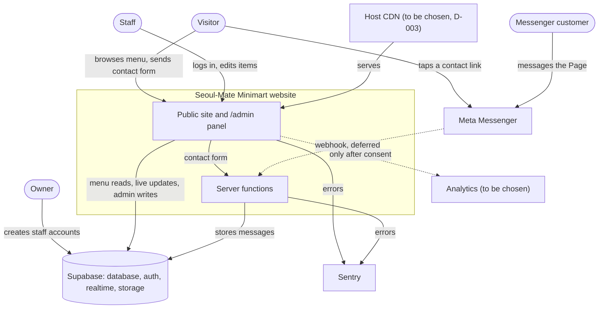
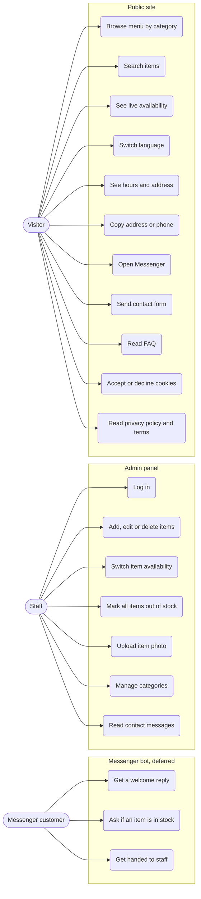

# Software Requirements Specification

| | |
|---|---|
| Status | 1.0, approved by the owner on 2026-10-18 |
| Last updated | 2026-10-19 |
| Structure | Based on ISO/IEC/IEEE 29148 |

## 1. Introduction

### 1.1 Purpose

This document owns **what** the Seoul-Mate Minimart website must do, as numbered, testable requirements. Why it exists is in [PRD.md](PRD.md), technical constraints are in [TRD.md](TRD.md), and how each requirement is built is in [SDD.md](SDD.md).

### 1.2 Scope

The system is a public menu website, a staff admin panel, and the database and server functions behind them. A Messenger bot is specified here but deferred by the owner ([D-004](DECISIONS.md#d-004-messenger-bot-deferred)).

### 1.3 Definitions

| Term | Meaning |
|---|---|
| Item | A product on the menu. |
| Published / hidden | A published item is visible to visitors. A hidden item is visible only to staff. |
| Available / out of stock | Whether an item can be bought right now. |
| Visitor | Anyone using the site without logging in. |
| Staff | A logged-in user listed in the `admins` table. |
| Owner | Staff member who also has access to the Supabase dashboard and creates staff accounts. |
| Locale | One of the site's languages: `en` (English), `fil` (Filipino), `ko` (Korean). |
| Messenger link | The m.me link in [BRIEF.md, Store hours](BRIEF.md#store-hours). |
| Store facts | Address, phone, hours and links in [BRIEF.md, Project inputs](BRIEF.md#project-inputs). |
| RLS | Row Level Security: Postgres rules that decide which rows each user may read or change. |
| Deferred | Required eventually, not built in v1, by owner decision. |

**Priorities:** Must (required for launch), Should (expected, can slip with owner approval), Could (if time allows).

## 2. Overall description

### 2.1 Actors

| Actor | What they do | Access |
|---|---|---|
| Visitor | Browses and searches the menu, reads store information, opens Messenger, sends the contact form | Read published menu data; send contact form through a server function |
| Staff | Logs in at `/admin`, edits items, categories and availability, reads contact messages | Read and write, enforced by RLS |
| Owner | Everything staff can do, plus creating and removing staff accounts in the Supabase dashboard | Supabase dashboard |
| Messenger customer (Deferred) | Messages the Facebook Page and gets automatic replies | None on the site |
| Meta Messenger Platform | Delivers Messenger events to the bot's webhook (Deferred) | Signed webhook calls only |

### 2.2 System context

Who and what the website talks to. Dashed lines are deferred or consent-dependent.

### 2.3 Use cases

What each actor can do. Staff can also do everything a visitor can.

### 2.4 Assumptions and constraints

- Assumptions are listed in [PRD.md, section 7](PRD.md#7-assumptions).
- Technical constraints are in [TRD.md](TRD.md).
- Business constraints: pickup only and orders through Messenger ([D-011](DECISIONS.md#d-011-pickup-only-orders-through-messenger)); Messenger allows replies only within 24 hours of the customer's last message; personal data is handled under the Philippine Data Privacy Act (RA 10173).

## 3. Functional requirements

### 3.1 Catalog

| ID | Requirement | Priority |
|---|---|---|
| FR-01 | The menu shows all published items, grouped by category, in the order staff set. | Must |
| FR-02 | Each item shows its name, description, price in Philippine pesos (₱), photo and availability. | Must |
| FR-03 | An item without a photo shows a neutral "Photo coming soon" placeholder. | Must |
| FR-04 | An out-of-stock item stays on the menu and shows an "Out of stock" text label. Availability is never shown by color alone. | Must |
| FR-05 | Visitors can filter the menu to one category and return to all categories. | Must |
| FR-06 | When staff change an item's availability, price, details or published state, every open visitor page shows the change within 5 seconds, without a reload. | Must |
| FR-07 | Hidden items are never sent to a visitor's browser. | Must |
| FR-08 | The menu shows "Last updated" with the date and time of the most recent availability change, read from the database and shown in Philippine time. | Must |
| FR-09 | If the live connection drops, the page retries automatically, reloads menu data once reconnected, and tells the visitor while live updates are paused. | Should |
| FR-10 | While the menu loads, item cards show skeleton placeholders, not a full-screen loader. | Must |
| FR-11 | If the menu cannot load, the page shows a plain error message and a Messenger link, with no technical details. | Must |

### 3.2 Search

| ID | Requirement | Priority |
|---|---|---|
| FR-12 | A search box filters items as the visitor types, matching item names, descriptions and category names in the current language and in English. | Must |
| FR-13 | Search ignores letter case and extra spaces. | Must |
| FR-14 | When nothing matches, the page says so and offers a Messenger link to ask about the item. | Must |
| FR-15 | Search input is treated as plain text. HTML, SQL or script typed into it is never executed or rendered as markup. | Must |

### 3.3 Languages

| ID | Requirement | Priority |
|---|---|---|
| FR-16 | The header, and the mobile menu, have a language button offering English, Filipino and 한국어, each label written in its own language. | Must |
| FR-17 | Choosing a language changes all interface text, category names, item names and descriptions, FAQ, legal pages, and date, time and price formats, without a full page reload. | Must |
| FR-18 | Each language has its own URL prefix (`/en/`, `/fil/`, `/ko/`), so a shared link opens in the same language. | Must |
| FR-19 | The site remembers the visitor's language choice for the next visit. | Must |
| FR-20 | On a first visit to the site root, the site uses the browser's preferred language if it is one of the three, otherwise English. | Must |
| FR-21 | When an item or category has no text in the chosen language, its English text is shown instead. No field is ever blank. | Must |

### 3.4 Store information

| ID | Requirement | Priority |
|---|---|---|
| FR-22 | The site shows the store's address, phone number and opening hours for each day, from the store facts. | Must |
| FR-23 | Opening hours that run past midnight show that they end the next day, for example "9:00 AM to 2:00 AM (next day)". | Must |
| FR-24 | The phone number is a tap-to-call link. | Must |
| FR-25 | Copy buttons copy the store address and the phone number to the clipboard and then show "Copied", which screen readers announce. | Must |
| FR-26 | A "How to order" section explains that customers order through Messenger, pick up in store and pay with cash or GCash, and that there is no delivery. | Must |

### 3.5 Contact

| ID | Requirement | Priority |
|---|---|---|
| FR-27 | Every public page has a floating contact button. | Must |
| FR-28 | The floating contact button and every other contact link open the Messenger link. | Must |
| FR-29 | A contact form accepts a name, a phone number or email address, and a message. | Should |
| FR-30 | The contact form is validated on the server. Invalid fields show inline errors and an error summary. | Should |
| FR-31 | While the contact form sends, its submit button is disabled and shows a spinner. On success, a success message replaces the form. | Should |
| FR-32 | Staff can read contact form messages in the admin panel, newest first. | Should |

### 3.6 FAQ

| ID | Requirement | Priority |
|---|---|---|
| FR-33 | An FAQ section shows store-written questions and answers in an accessible accordion. Placeholder entries are marked TODO, and a production build fails while any TODO entry remains. | Should |

### 3.7 Admin panel

| ID | Requirement | Priority |
|---|---|---|
| FR-34 | Staff log in at `/admin` with email and password. There is no sign-up page. | Must |
| FR-35 | A failed login shows "Wrong email or password", whatever the reason. | Must |
| FR-36 | The password field has a show or hide toggle with an accessible label. | Must |
| FR-37 | Only users listed in the `admins` table can change data. A logged-in user who is not listed cannot read admin-only data or write anything. | Must |
| FR-38 | Staff can create, edit and delete items: name and description (English required, Filipino and Korean optional), category, price, photo, published and available. | Must |
| FR-39 | Staff can switch an item between available and out of stock with a single control in the item list. | Must |
| FR-40 | Staff can mark all items out of stock in one action. | Must |
| FR-41 | Deleting an item and every bulk action ask for confirmation in a modal. Escape or Cancel leaves data unchanged. | Must |
| FR-42 | Staff can create, rename (in all three languages), reorder and delete categories. A category that still has items cannot be deleted. | Should |
| FR-43 | Staff can upload one photo per item: JPG, PNG or WebP, up to 5 MB. Other files are rejected with a clear message. | Must |
| FR-44 | Stored photos carry no EXIF or location metadata and are stored in several sizes, as WebP, or as JPEG when the uploading browser cannot create WebP ([D-019](DECISIONS.md#d-019-photos-are-processed-in-the-staff-members-browser)). | Must |
| FR-45 | Admin forms show inline field errors, an error summary, a success message, and a disabled submit button with a spinner while saving. | Must |
| FR-46 | An admin session ends after 60 minutes without activity, or 12 hours after login, whichever comes first ([D-016](DECISIONS.md#d-016-admin-session-limits)). Staff can log out at any time. | Must |
| FR-47 | Staff can turn on two-factor login with an authenticator app. | Should |

### 3.8 Messenger bot (Deferred)

Deferred by the owner ([D-004](DECISIONS.md#d-004-messenger-bot-deferred)). Kept here so the design leaves room for it.

| ID | Requirement | Priority |
|---|---|---|
| FR-48 | The webhook rejects any request without a valid `X-Hub-Signature-256` signature made with the app secret. | Must, Deferred |
| FR-49 | On a customer's first message or the Get Started button, the bot sends the welcome message from the store facts. The Messenger greeting text is set. | Must, Deferred |
| FR-50 | When a customer asks about an item, the bot looks it up. If it is out of stock, the bot says so and suggests up to three available items from the same category. If it is available, the bot says so. | Must, Deferred |
| FR-51 | Any other message gets a reply that staff will answer during store hours, and the conversation is left for a person. | Must, Deferred |
| FR-52 | The bot replies only to incoming messages, within Messenger's 24-hour window, and never sends broadcasts. | Must, Deferred |
| FR-53 | The bot replies in English, Filipino or Korean, matching the customer's message where it can tell, otherwise English. | Could, Deferred |

### 3.9 Privacy, consent and legal

| ID | Requirement | Priority |
|---|---|---|
| FR-54 | On a first visit, a cookie banner offers Accept and Decline buttons of equal prominence, with a link to the privacy policy. | Must |
| FR-55 | No analytics script loads, and no non-essential cookie or storage is set, before the visitor accepts. | Must |
| FR-56 | The consent choice is remembered. A "Cookie settings" link in the footer lets the visitor change it. | Must |
| FR-57 | After consent, the site captures `utm_source`, `utm_medium`, `utm_campaign`, `utm_term` and `utm_content` from the landing URL, keeps them for the browser session, and attaches them to analytics events and contact form messages. Without consent, none are stored. | Must |
| FR-58 | A Privacy Policy page explains what is collected (analytics, contact form, Messenger), why, how long it is kept, which third parties are involved (Meta, Supabase, Sentry, the host) and how to contact the store. It is written for RA 10173, marked as needing legal review, and shows its last updated date. | Must |
| FR-59 | A Terms page covers changing prices and availability, how ordering through Messenger and pickup work, and liability limits. It is marked as needing legal review and shows its last updated date. | Must |

### 3.10 Layout and display

| ID | Requirement | Priority |
|---|---|---|
| FR-60 | The header stays visible while scrolling. Jumping to an in-page heading never hides that heading under the header. | Must |
| FR-61 | On small screens, a menu button opens the navigation. It closes on Escape or a link tap, and keeps keyboard focus inside while open. | Must |
| FR-62 | The first focusable element on every page is a "Skip to content" link, visible when focused. | Must |
| FR-63 | A back to top button appears after the visitor scrolls one screen height. | Must |
| FR-64 | A thin progress bar under the header shows scroll progress on the menu and legal pages. | Must |
| FR-65 | The floating contact button, back to top button and cookie banner never overlap each other. | Must |
| FR-66 | A theme toggle switches between light and dark. The default follows the system setting, the choice is remembered, and the page never flashes the wrong theme while loading. | Must |
| FR-67 | Every interactive element has a hover style and a matching `:focus-visible` style. | Must |
| FR-68 | Printing the menu gives item names, prices and availability only, without navigation, buttons, banners or floating elements. | Must |
| FR-69 | The site has an SVG favicon with PNG fallbacks, an Apple touch icon and a web manifest. | Must |

## 4. Non-functional requirements

### 4.1 Security

| ID | Requirement |
|---|---|
| NFR-SEC-01 | Every table has Row Level Security enabled. Without a matching policy, a role has no access. |
| NFR-SEC-02 | The anonymous role can only read published menu data. It cannot insert, update or delete any row in any table. |
| NFR-SEC-03 | Writes are allowed only for users listed in the `admins` table. Being logged in is not enough. |
| NFR-SEC-04 | No SQL is built from strings. Queries use the Supabase query builder or parameters. |
| NFR-SEC-05 | Database functions take parameters, set a fixed `search_path`, and use `SECURITY INVOKER` unless a recorded decision says otherwise. |
| NFR-SEC-06 | The Supabase service role key, Meta app secret and Page access token exist only in server environment variables, never in the browser bundle or in git. |
| NFR-SEC-07 | The production bundle is minified, has no public source maps and no debug logging. Source maps go privately to Sentry only. |
| NFR-SEC-08 | `.env` files are git-ignored, `.env.example` lists variable names only, GitHub secret scanning and push protection are on, and git history contains no secrets. |
| NFR-SEC-09 | Every server endpoint validates its input with a schema (type, length, allowed characters) and rejects anything else. |
| NFR-SEC-10 | Content entered by visitors or staff is never rendered as raw HTML. |
| NFR-SEC-11 | Every response carries a Content-Security-Policy without inline scripts and with `frame-ancestors 'none'`, plus `Strict-Transport-Security`, `X-Content-Type-Options: nosniff`, `Referrer-Policy: strict-origin-when-cross-origin` and a `Permissions-Policy`. Verifiable only once a host is chosen ([D-003](DECISIONS.md#d-003-hosting-deferred)). |
| NFR-SEC-12 | Server endpoints accept cross-origin requests only from the site's own origin. |
| NFR-SEC-13 | Admin writes are protected against cross-site request forgery. |
| NFR-SEC-14 | Only staff can upload photos. Storage rules enforce the allowed types and size limit from FR-43. |
| NFR-SEC-15 | Errors shown to users are generic. Details go only to Sentry. Responses never include stack traces. |
| NFR-SEC-16 | Admin login, the contact form, the Messenger webhook (Deferred) and any AI call are rate-limited per IP address. Requests over the limit get `429` with `Retry-After`. |
| NFR-SEC-17 | The contact form has a hidden honeypot field. Messages that fill it are discarded while the sender still sees the normal success message. |
| NFR-SEC-18 | The lockfile is committed. CI runs a dependency audit and fails on high or critical issues. Dependabot opens update pull requests. No dependency is unmaintained (no release or maintainer activity in 12 months) unless a recorded decision allows it. |

### 4.2 Performance

| ID | Requirement |
|---|---|
| NFR-PERF-01 | On a mid-range Android phone over 4G, at the 75th percentile: Largest Contentful Paint 2.5 s or less, Interaction to Next Paint 200 ms or less, Cumulative Layout Shift 0.1 or less. |
| NFR-PERF-02 | The public site loads 170 KB or less of gzipped JavaScript. Admin code loads only under `/admin`. |
| NFR-PERF-03 | Photos are served in the format stored under FR-44, sized for the screen, and lazy-loaded below the first screen. |
| NFR-PERF-04 | Hashed static files are cached for one year. HTML is cached for at most 5 minutes. Availability is always read live from the database, never from a cache. |
| NFR-PERF-05 | Search results update within 100 ms of a keystroke, for 1,000 items on a mid-range phone. |
| NFR-PERF-06 | Database columns used for filtering and sorting have indexes. |

### 4.3 Accessibility

| ID | Requirement |
|---|---|
| NFR-ACC-01 | The site meets WCAG 2.2 level AA and uses semantic HTML. |
| NFR-ACC-02 | Every feature works with keyboard only, on mobile and desktop, in light and dark themes. |
| NFR-ACC-03 | Text and controls meet AA contrast in both themes. |
| NFR-ACC-04 | Animations are short and functional, and are switched off when the visitor prefers reduced motion. |
| NFR-ACC-05 | Text in a language other than the page's language, such as an English fallback on the Korean page, is marked with its own `lang` attribute. |
| NFR-ACC-06 | Touch targets are at least 24 by 24 CSS pixels, and primary actions at least 44 by 44. |
| NFR-ACC-07 | A focused element is never hidden by the sticky header, floating buttons or cookie banner. |

### 4.4 Privacy

| ID | Requirement |
|---|---|
| NFR-PRIV-01 | Error reports sent to Sentry are scrubbed of names, email addresses, phone numbers, IP addresses and message text. |
| NFR-PRIV-02 | Fonts and other static files are self-hosted. Before consent, the browser contacts only the site itself, Supabase and Sentry. |
| NFR-PRIV-03 | Contact messages are deleted automatically when the retention period ends ([PRD Q9](PRD.md#8-open-questions)). |
| NFR-PRIV-04 | Only the language, theme and consent choices are stored in the browser before consent, as settings the visitor asked for. The privacy policy lists them. |
| NFR-PRIV-05 | Personal data handling and the privacy policy are reviewed against RA 10173 before launch. |

### 4.5 Reliability

| ID | Requirement |
|---|---|
| NFR-REL-01 | If Supabase is unreachable, public pages still load, show the error state from FR-11, and keep the Messenger and phone links working. |
| NFR-REL-02 | Server function errors are reported to Sentry, and the owner is alerted about repeated failures. |
| NFR-REL-03 | An uptime check tests the site and a database-backed menu read at least every 5 minutes and alerts the owner. |
| NFR-REL-04 | The database can be restored from a backup no older than 24 hours. The restore steps are documented and tested once before launch. |
| NFR-REL-05 | A bad release can be rolled back to the previous version in under 10 minutes. Verifiable only once a host is chosen ([D-003](DECISIONS.md#d-003-hosting-deferred)). |

## 5. External interfaces

| Interface | Used for | Status |
|---|---|---|
| Messenger link (m.me) | Contact links and floating button | v1 |
| Meta Messenger Platform (webhooks, Send API) | Messenger bot | Deferred ([D-004](DECISIONS.md#d-004-messenger-bot-deferred)) |
| Supabase database API | Menu reads, admin writes | v1 |
| Supabase Auth | Staff login, two-factor login | v1 |
| Supabase Realtime | Live availability | v1 |
| Supabase Storage | Item photos | v1 |
| Supabase Edge Functions | Contact form; Messenger webhook later | v1 ([D-005](DECISIONS.md#d-005-server-code-runs-on-supabase-edge-functions)) |
| Host CDN | Serving the site and security headers | Deferred ([D-003](DECISIONS.md#d-003-hosting-deferred)) |
| Sentry | Error tracking | v1 |
| Analytics | Visits and Messenger taps, after consent | Deferred with hosting |

Every endpoint's method, path, auth, rate limit, schemas and error codes are in [SDD.md, section 3](SDD.md#3-interface-design).

## 6. Traceability matrix

Tests are filled in during steps 4 to 9. Each range is split into one row per requirement as its tests are written. Unit tests are `src/**/*.test.ts(x)` (Vitest), end-to-end tests are `e2e/*.spec.ts` (Playwright, at phone and desktop sizes), and database tests are in `supabase/tests/database` (pgTAP).

### 6.1 Verified

| Requirement | SDD section | Verified by |
|---|---|---|
| FR-01 | [2.2](SDD.md#22-public-site-modules) catalog | `menuView.test.ts`; `catalog.spec.ts` (items by category) |
| FR-02 | [2.2](SDD.md#22-public-site-modules) catalog | `format.test.ts` (prices); `App.test.tsx`; `catalog.spec.ts` |
| FR-03 | [2.2](SDD.md#22-public-site-modules) catalog | `App.test.tsx`; `catalog.spec.ts` |
| FR-04 | [2.2](SDD.md#22-public-site-modules) catalog, [4.1](SDD.md#41-item-states) | `menuView.test.ts`; `App.test.tsx`; `catalog.spec.ts` |
| FR-05 | [2.2](SDD.md#22-public-site-modules) catalog | `menuView.test.ts`; `App.test.tsx`; `catalog.spec.ts` (filter through the address) |
| FR-06 | [2.2](SDD.md#22-public-site-modules) catalog, [7.1](SDD.md#71-live-availability-update) | `liveMenu.test.ts`; `catalog.spec.ts` (live update without a reload); `live-stack.spec.ts` (real stack, CI) |
| FR-07 | [2.2](SDD.md#22-public-site-modules) catalog, [5.3](SDD.md#53-database-access) | `02_visitor_access.test.sql`; `live-stack.spec.ts` (response body, CI) |
| FR-08 | [2.2](SDD.md#22-public-site-modules) catalog | `menuView.test.ts`; `format.test.ts`; `App.test.tsx`; `catalog.spec.ts` |
| FR-09 | [2.2](SDD.md#22-public-site-modules) catalog | `liveMenu.test.ts`; `catalog.spec.ts` (connection dropped) |
| FR-10 | [2.2](SDD.md#22-public-site-modules) catalog | `App.test.tsx`; `catalog.spec.ts` |
| FR-11 | [2.2](SDD.md#22-public-site-modules) catalog, [6](SDD.md#6-error-handling-and-logging) | `App.test.tsx`; `catalog.spec.ts`; `layout.spec.ts` (axe on the error state) |
| FR-12 | [2.2](SDD.md#22-public-site-modules) search | `searchIndex.test.ts`; `App.test.tsx`; `catalog.spec.ts` |
| FR-13 | [2.2](SDD.md#22-public-site-modules) search | `searchIndex.test.ts`; `catalog.spec.ts` |
| FR-14 | [2.2](SDD.md#22-public-site-modules) search | `App.test.tsx`; `catalog.spec.ts` |
| FR-15 | [2.2](SDD.md#22-public-site-modules) search | `searchIndex.test.ts`; `App.test.tsx`; `catalog.spec.ts` (injection strings: no markup, no dialogs, no requests) |
| FR-16 | [2.2](SDD.md#22-public-site-modules) i18n | `App.test.tsx`; `languages.spec.ts` (header and mobile menu) |
| FR-17 | [2.2](SDD.md#22-public-site-modules) i18n | `translations.test.ts` (same keys in every language); `languages.spec.ts` |
| FR-18 | [2.2](SDD.md#22-public-site-modules) i18n | `locales.test.ts`; `languages.spec.ts` |
| FR-19 | [2.2](SDD.md#22-public-site-modules) i18n | `App.test.tsx`; `languages.spec.ts` |
| FR-20 | [2.2](SDD.md#22-public-site-modules) i18n | `locales.test.ts`; `App.test.tsx`; `languages.spec.ts` (Korean, Tagalog and unsupported browsers) |
| FR-21 | [2.2](SDD.md#22-public-site-modules) i18n | `locales.test.ts`; `App.test.tsx`; `languages.spec.ts` |
| FR-22 | [2.2](SDD.md#22-public-site-modules) store-info | `hours.test.ts`; `App.test.tsx`; `layout.spec.ts` |
| FR-23 | [2.2](SDD.md#22-public-site-modules) store-info | `hours.test.ts`; `layout.spec.ts`; `languages.spec.ts` |
| FR-24 | [2.2](SDD.md#22-public-site-modules) store-info | `App.test.tsx`; `layout.spec.ts` |
| FR-25 | [2.2](SDD.md#22-public-site-modules) store-info | `CopyButton.test.tsx` (clipboard allowed and blocked); `layout.spec.ts` |
| FR-26 | [2.2](SDD.md#22-public-site-modules) store-info | `App.test.tsx` |
| FR-27 | [2.2](SDD.md#22-public-site-modules) contact | `App.test.tsx`; `layout.spec.ts` |
| FR-28 | [2.2](SDD.md#22-public-site-modules) contact | `App.test.tsx`; `catalog.spec.ts`; `layout.spec.ts` |
| FR-60 | [2.2](SDD.md#22-public-site-modules) layout | `layout.spec.ts` (anchored heading below the sticky header) |
| FR-61 | [2.2](SDD.md#22-public-site-modules) layout | `layout.spec.ts` (focus stays inside, Escape closes); `languages.spec.ts` (link tap closes) |
| FR-62 | [2.2](SDD.md#22-public-site-modules) layout | `layout.spec.ts` |
| FR-34 | [2.3](SDD.md#23-admin-panel-modules) auth | `admin.spec.ts` (login page, no sign-up); `live-stack.spec.ts` (real login, CI) |
| FR-35 | [2.3](SDD.md#23-admin-panel-modules) auth | `admin.spec.ts` (wrong password and unknown email read the same) |
| FR-36 | [2.3](SDD.md#23-admin-panel-modules) auth | `admin.spec.ts` (toggle with `aria-pressed`) |
| FR-37 | [2.3](SDD.md#23-admin-panel-modules) auth, items; [5.3](SDD.md#53-database-access) | `03_signed_in_non_staff.test.sql`; `admin.spec.ts` (non-staff logged out, refused change put back); `live-stack.spec.ts` (non-staff, CI) |
| FR-38 | [2.3](SDD.md#23-admin-panel-modules) items | `schemas.test.ts`; `admin.spec.ts` (add, edit, delete) |
| FR-39 | [2.3](SDD.md#23-admin-panel-modules) items | `admin.spec.ts` (switch, and an open visitor page follows); `live-stack.spec.ts` (through RLS and Realtime, CI) |
| FR-40 | [2.3](SDD.md#23-admin-panel-modules) items | `04_staff_access.test.sql` (one version bump); `admin.spec.ts` |
| FR-41 | [2.3](SDD.md#23-admin-panel-modules) confirm-modal | `admin.spec.ts` (Escape and Cancel change nothing, focus returns) |
| FR-42 | [2.3](SDD.md#23-admin-panel-modules) categories | `06_constraints.test.sql`; `schemas.test.ts`; `admin.spec.ts` (category with items refused) |
| FR-43 | [2.3](SDD.md#23-admin-panel-modules) photos | `adminLogic.test.ts` (first bytes, size); `admin.spec.ts` (a renamed SVG refused); `04_staff_access.test.sql` (path rule) |
| FR-44 | [2.3](SDD.md#23-admin-panel-modules) photos | `admin.spec.ts` (three WebP sizes, no EXIF or location left); `live-stack.spec.ts` (real storage, CI) |
| FR-45 | [2.3](SDD.md#23-admin-panel-modules) items | `admin.spec.ts` (error summary takes focus and links to fields; saved message) |
| FR-46 | [2.3](SDD.md#23-admin-panel-modules) auth, [5.4](SDD.md#54-staff-sessions) | `adminLogic.test.ts` (both limits); `admin.spec.ts` (logged out after 60 idle minutes) |
| FR-47 | [2.3](SDD.md#23-admin-panel-modules) auth | `04_staff_access.test.sql` (two-factor rule); `admin.spec.ts` (setup, then a code at login) |
| FR-33 | [2.2](SDD.md#22-public-site-modules) faq | `siteContent.test.ts` (same entries in every language); `site.spec.ts` (keyboard, Draft label); production build check in `vite.config.ts` (fails while any entry is marked todo) |
| FR-54 | [2.2](SDD.md#22-public-site-modules) consent | `site.spec.ts` (banner on first visit; Accept and Decline equal in size and style; link to the policy) |
| FR-55 | [2.2](SDD.md#22-public-site-modules) consent | `consent.test.ts`; `site.spec.ts` (no storage before a choice); `layout.spec.ts` (hosts contacted before consent). No analytics provider yet (D-003) |
| FR-56 | [2.2](SDD.md#22-public-site-modules) consent | `consent.test.ts`; `site.spec.ts` (choice remembered; "Privacy choices" reopens the banner) |
| FR-57 | [2.2](SDD.md#22-public-site-modules) consent, [7.3](SDD.md#73-cookie-consent-analytics-and-utm) | `consent.test.ts` (five keys only, saved for the session only after Accept, cleared on Decline); `site.spec.ts`. Attached to contact messages in step 8 part 2 |
| FR-58 | [2.2](SDD.md#22-public-site-modules) legal | `siteContent.test.ts` (required topics, same sections in every language); `site.spec.ts`; legal review (PRD S7) |
| FR-59 | [2.2](SDD.md#22-public-site-modules) legal | `siteContent.test.ts`; `site.spec.ts`; legal review (PRD S7) |
| FR-63 | [2.2](SDD.md#22-public-site-modules) layout | `site.spec.ts` (appears after one screen; returns to the top and moves focus) |
| FR-64 | [2.2](SDD.md#22-public-site-modules) layout | `site.spec.ts` (on the legal pages, 0 at the top and 1 at the bottom) |
| FR-65 | [2.2](SDD.md#22-public-site-modules) layout | `site.spec.ts` (banner, back to top and Messenger button do not overlap); `layout.spec.ts` |
| FR-66 | [2.2](SDD.md#22-public-site-modules) layout | `siteContent.test.ts`; `site.spec.ts` (system setting before paint, choice remembered) |
| FR-67 | [2.2](SDD.md#22-public-site-modules) layout, [UI-UX 3](UI-UX.md#3-components-and-states) | Styles pair every hover with `:focus-visible`; axe checks; manual keyboard check (step 11) |
| FR-68 | [2.2](SDD.md#22-public-site-modules) layout | `site.spec.ts` (print media keeps names, prices and stock) |
| FR-69 | [2.2](SDD.md#22-public-site-modules) layout | `site.spec.ts` (head links and files served, manifest contents) |

Manual screen reader checks for FR-60 to FR-62 are still to do (step 11).

### 6.2 Still to split

| Requirements | Area | SDD section | Verified by (planned) |
|---|---|---|---|
| FR-29 to FR-32 | Contact form | [2.2](SDD.md#22-public-site-modules) contact, [2.4](SDD.md#24-server-functions), [3.2](SDD.md#32-contact-function) | End-to-end tests; server function tests |
| FR-48 to FR-53 | Messenger bot (Deferred) | [2.4](SDD.md#24-server-functions), [2.5](SDD.md#25-reply-engine-deferred), [3.3](SDD.md#33-messenger-webhook-deferred), [7.4](SDD.md#74-messenger-message-deferred), [7.5](SDD.md#75-bot-reply-logic-deferred) | Server function tests; reply engine unit tests |
| NFR-SEC-01 to NFR-SEC-03 | Database access | [5.3](SDD.md#53-database-access) | `supabase/tests/database` files 01 to 04 (pgTAP), run in CI ([BACKEND-SCHEMA 8](BACKEND-SCHEMA.md#8-tests)) |
| NFR-SEC-04 to NFR-SEC-18 | Other security | [5.2](SDD.md#52-threat-model-stride) and [5.4 to 5.9](SDD.md#54-staff-sessions) | Lint rules, CI dependency audit, bundle secret scan, header checks, injection tests. NFR-SEC-13 by design (D-022). NFR-SEC-14 in `04_staff_access.test.sql` and `live-stack.spec.ts`. NFR-SEC-16 for login: Supabase Auth, `429` without `Retry-After` (D-033) |
| NFR-PERF-01 to NFR-PERF-06 | Performance | [2.1](SDD.md#21-frontend-structure); ARCHITECTURE [5](ARCHITECTURE.md#5-caching) and [6](ARCHITECTURE.md#6-scaling) | Lighthouse CI (planned); bundle size check in CI, `check-bundle.mjs` (NFR-PERF-02); search benchmark in `searchIndex.test.ts` (NFR-PERF-05) |
| NFR-ACC-01 to NFR-ACC-07 | Accessibility | [2.2](SDD.md#22-public-site-modules) layout and i18n; [UI-UX.md](UI-UX.md) | axe checks in `layout.spec.ts`, `site.spec.ts` and `admin.spec.ts` (English and Korean, light and dark, phone and desktop); fallback `lang` in `App.test.tsx` (NFR-ACC-05); manual audit |
| NFR-PRIV-01 to NFR-PRIV-05 | Privacy | [5.7](SDD.md#57-secrets), [6](SDD.md#6-error-handling-and-logging), [7.3](SDD.md#73-cookie-consent-analytics-and-utm) | Hosts contacted before consent in `layout.spec.ts` (NFR-PRIV-02); storage before consent in `consent.test.ts` and `site.spec.ts` (NFR-PRIV-04); Sentry scrubbing test; legal review |
| NFR-REL-01 to NFR-REL-05 | Reliability | [6](SDD.md#6-error-handling-and-logging); ARCHITECTURE [7](ARCHITECTURE.md#7-error-tracking-and-monitoring) and [8](ARCHITECTURE.md#8-backups-and-recovery) | Menu error state in `catalog.spec.ts` (NFR-REL-01); restore drill; uptime monitor |
